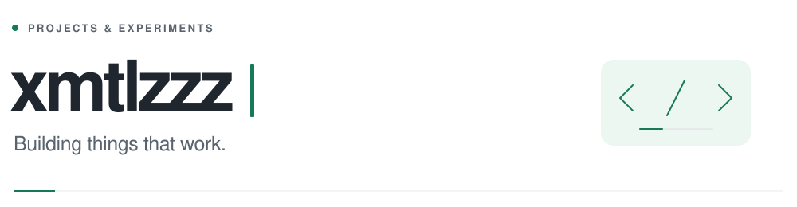

<picture>
  <source media="(prefers-color-scheme: dark)" srcset="./assets/header-dark.svg">
  
</picture>

I build **developer tools, backend systems, and web apps** — usually to make something I do every day a little easier.

[Projects](https://vmaker.xmtlz.dev) &nbsp; / &nbsp; [Writing](https://vblog.xmtlz.dev) &nbsp; / &nbsp; [Email](mailto:xmtlzloveasuka@gmail.com)

 

## Selected work

<table>
<tr>
<td width="50%" valign="top">
01 &nbsp; / &nbsp; AGENT TOOLING
<h3><a href="https://github.com/xmtlzzz/dsh-any-agent">dsh-any-agent ↗</a></h3>

A long-lived coding buddy for any MCP client. Dispatch work, resume conversations, and collect results.

JavaScript · MCP · DeepSeek Harness

<a href="https://dsh-any-agent.xmtlz.dev">Explore the project →</a>
</td>
<td width="50%" valign="top">
02 &nbsp; / &nbsp; OBSERVABILITY
<h3><a href="https://github.com/xmtlzzz/vPulse">vPulse ↗</a></h3>

Service health at a glance. Scheduled checks, latency history, and an incident timeline on Cloudflare.

TypeScript · React · Workers · D1

<a href="https://vpulse.xmtlzloveasuka.workers.dev">Open the dashboard →</a>
</td>
</tr>
<tr>
<td width="50%" valign="top">
03 &nbsp; / &nbsp; CLOUD UTILITIES
<h3><a href="https://github.com/xmtlzzz/cloudPulse">CloudPulse ↗</a></h3>

One desktop dashboard for cloud usage and quotas across Vercel, Neon, Supabase, and Cloudflare.

Go · Wails · React · TypeScript

<a href="https://github.com/xmtlzzz/cloudPulse#readme">See how it works →</a>
</td>
<td width="50%" valign="top">
04 &nbsp; / &nbsp; DESKTOP TOOLS
<h3><a href="https://github.com/xmtlzzz/codeviewer">CodeViewer ↗</a></h3>

A personal view of local Git activity: commits, code changes, and trends across your repositories.

Rust · Tauri · React

<a href="https://github.com/xmtlzzz/codeviewer#readme">See how it works →</a>
</td>
</tr>
</table>

More things I've built: [vMaker](https://github.com/xmtlzzz/vMaker) · [vBlog Core](https://github.com/xmtlzzz/vBlog-Core) · [vInvoice](https://github.com/xmtlzzz/vInvoice)

 

## The toolbox

**Languages** &nbsp; Python · Go · TypeScript · JavaScript · Rust  
**Web & desktop** &nbsp; React · Vue · Next.js · Tauri · Wails  
**Infrastructure** &nbsp; Linux · Docker · GitHub Actions · PostgreSQL · Redis

 

GitHub stats

 

<picture>
  <source media="(prefers-color-scheme: dark)" srcset="https://github-readme-stats-omega-livid-20.vercel.app/api?username=xmtlzzz&amp;show_icons=true&amp;hide_border=true&amp;bg_color=0d1117&amp;title_color=65d6ad&amp;icon_color=65d6ad&amp;text_color=919baa">
  
</picture>

 

Always learning, always building. &nbsp; / &nbsp; <a href="mailto:xmtlzloveasuka@gmail.com">Say hello →</a>

